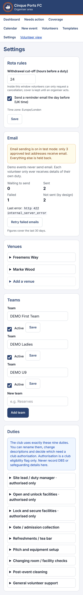

# Phase 6 test report

**Date:** 17 October 2026 · PostgreSQL 16.15 · Node 22.22 · Next.js 16.4.2 · Vitest 5.0.5 · Playwright 1.56 (375×812, touch)

| Check | Result |
|---|---|
| Lint / Typecheck | ✅ 0 problems / 0 errors |
| Production build | ✅; 0 error lines in the server log across all runs |
| Unit + database tests | ✅ **348 / 348** (19 files; new: `outbox.db.test.ts` 15, `email.test.ts` 42, plus privilege and path additions) |
| Email end-to-end checks (`phase6-email.mts`) | ✅ **39 / 39**, two clean runs |
| Regression: Phase 3 / 4 / 5 phone checks | ✅ 25 / 25, 37 / 37, 47 / 47 (run with email switched **on** in staging mode) |
| Secrets in browser bundle | ✅ none: the scan of `.next/static` looked for the email key, cron secret, Supabase secret and their variable names |
| Addresses in server logs | ✅ none (`grep @test.local` on the server log: 0) |

No real email was sent. Every run pointed the worker at a fake provider inside the test server, in staging mode with a three-address test allow-list.

## Required Phase 6 assertions
- **Idempotent delivery.** Each message is claimed by one worker only, even when two claim at once (database test). After a simulated crash between sending and recording, the retry is answered by the provider's idempotency store and **no second email is delivered** (end to end: sent 1→1, repeats 1). A late duplicate "failed" callback can't undo a sent message.
- **Retries.** A 503 puts the message back with a ~2-minute delay. It then sends on attempt 2, and exactly one copy is delivered. Backoff runs 2/4/8/16 minutes, with **failed** after 5 attempts. A permanent rejection (422) fails at once. The admin "Retry failed emails" button re-queues it and it sends.
- **Confirmation / change / cancellation / reminder messages.** All 17 kinds the database queues have a template (a test fails if a kind is ever added without one). Sign-up and withdrawal emails go out within seconds of the change, without waiting for the schedule. Reminders are queued once for tomorrow's **UK** date and are due at 18:00 UK time.
- **Send-time suppression.** Reminders for a duty withdrawn after queuing, messages to a suspended volunteer, demo events, addresses not on the staging allow-list, and messages about duties that have already started are all suppressed, never sent.
- **No secrets in the frontend.** The bundle scan is clean, and the Settings page shows only whether sending is on, test mode, and counts.
- **Timezone checks.** Database tests cover a duty at 00:30 BST on 27 Oct 2030 (still 26 Oct in UTC; the clocks go back that night): the reminder is keyed to the 27th and due at 18:00 BST on the 26th. Templates show BST in summer, GMT in winter, and "(next day)" after midnight.
- **Security regression.** The cron endpoint returns 401 without the exact bearer secret (and is not redirected to sign-in). Signed-in users, admins included, and anonymous callers are refused the outbox table and all worker functions. The privilege sweep allows the service role exactly the four worker functions. Security headers are present on every response.

## Defects found and fixed in Phase 6
1. **"Retry failed emails" confirmation vanished**: the button only showed while failures existed, so it disappeared once the retry worked. It is now always on the Email card.
2. Two test-script timing issues (reading the outbox a moment before the worker recorded the send, and the wrong My Duties tab). The tests now wait for the saved state. No app change was needed.

## Not yet done (Phase 7)
- Choosing the scheduler (Vercel Cron if the plan allows frequent runs, otherwise Supabase `pg_cron` + `pg_net`; D-606) and verifying the club's sending domain (Q7).
- A full script Content-Security-Policy (needs nonces; D-610).

## Email end-to-end checks (verbatim)
```
PASS  cron: no token → 401 (not a redirect to sign-in)
PASS  cron: wrong token → 401
PASS  cron: secret without 'Bearer' → 401
PASS  cron: correct token → 200 with counts only ({"enabled":true,"reminders":0,"claimed":0,"sent":0,"retrying":0,"failed":0,"suppressed":0})
PASS  cron response is not cacheable
PASS  header: X-Content-Type-Options nosniff
PASS  header: X-Frame-Options DENY
PASS  header: CSP frame-ancestors 'none'
PASS  header: Referrer-Policy strict-origin-when-cross-origin
PASS  header: HSTS set
PASS  header: Permissions-Policy blocks camera/mic/location
PASS  header: no X-Powered-By
PASS  sign-up confirmation sent straight after the change (no cron needed)
PASS  email shows the duty, event and UK time with GMT/BST (When: Tuesday, 20 October 2026, 13:00–14:00 BST)
PASS  email contains no other volunteer's name, email or phone (no roster)
PASS  email links into the app
PASS  email used the outbox dedupe key as Idempotency-Key
PASS  outbox row marked sent with the provider's message id (sent)
PASS  re-sent after a simulated crash: provider idempotency stops a duplicate (sent 1→1, repeats 1)
PASS  …and the row is sent again
PASS  503 from the provider → back in the queue with a later retry time (pending http 503 internal_server_error)
PASS  retry delay is ~2 minutes
PASS  on the next run it is sent, on attempt 2
PASS  exactly one withdrawal email delivered
PASS  staging: address not on the allow-list is suppressed, not sent
PASS  staging: nothing ever delivered to other@test.local
PASS  demo event email is suppressed and never delivered
PASS  permanent provider error → failed immediately (no pointless retries) (failed http 422 internal_server_error)
PASS  stored error has no address in it
PASS  settings: admin sees email is on in TEST mode with the allow-list size
PASS  settings: counts shown, no addresses on the page
PASS  admin 'Retry failed emails' re-queues and it sends
PASS  coordinator can't open the email settings
PASS  reminder queued once for tomorrow's duty (two cron runs) (1)
PASS  reminder keyed on the UK date (reminder:5abf9a05-7613-421f-8070-badb9a1f4604:2026-10-18)
PASS  reminder due at 18:00 UK today (or now if later)
PASS  reminder delivered with the duty details
PASS  browser bundle contains no email/cron/secret keys or their names
PASS  rendered settings page contains no keys or allow-listed addresses
39/39 checks passed
```


